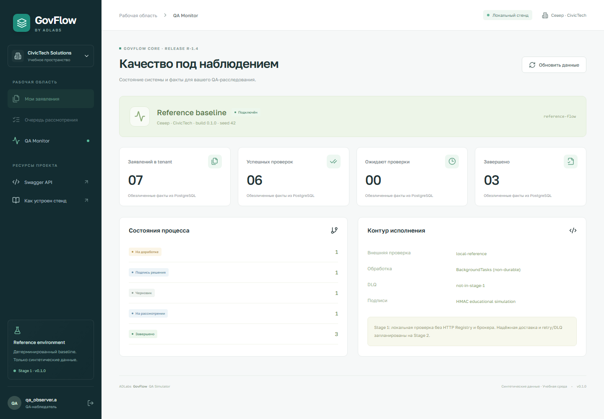
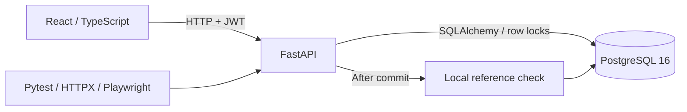

# GovFlow — Technical QA Portfolio

[](https://github.com/topchik77/adlabs-govflow-qa/actions/workflows/qa.yml)


**Воспроизводимый QA-стенд для проверки сложного бизнес-процесса на уровнях Web, API и PostgreSQL.**

GovFlow моделирует обработку электронного заявления: черновик → документ → подпись заявителя → проверка сведений → рассмотрение специалистом → подпись решения → завершение. Процесс работает для нескольких изолированных организаций и ролей.

Проект показывает инженерный подход к качеству: **требование → риск → тест-дизайн → API/SQL-проверка → evidence → релизное решение**. Код приложения, автотесты и документация доступны для повторной проверки.

**Проверенные локальные результаты:** 49 backend-проверок на PostgreSQL · 3 браузерных сценария · 33 связанных тест-кейса. Backend suite выполнен на Windows/Python 3.14 и Docker/Linux/Python 3.12. Параметризованные проверки учитываются как отдельные test executions. Актуальный статус GitHub Actions — в badge выше; локальные [JUnit-отчёты](reports/verification.json) сохранены отдельно.


*Заявления и статусы на скриншоте созданы через настоящее API и сохранены в PostgreSQL. Данные синтетические.*

## Зачем этот проект

В многоэтапной системе успешного HTTP-ответа недостаточно. Нужно доказать, что пользователь видит только разрешённые данные, актуальная подпись соответствует документу, повтор команды не создаёт второй бизнес-эффект, а решение и аудит сохраняются согласованно.

GovFlow даёт воспроизводимую среду для проверки этих рисков. Его можно запустить локально, исследовать через DevTools/Swagger/Postman, проверить SQL-запросами и прогнать регрессию. На техническом интервью один сценарий можно проследить от требования до состояния БД.

## Что здесь показывает уровень QA

| Инженерная задача | Конкретная проверка | Доказательство |
|---|---|---|
| **Изоляция данных и object-level access** | Один UUID запрашивают пользователи разных tenant и другой владелец; проверяются карточка, аудит, интеграции, вложения и список | 404 без утечки; tenant/owner-фильтр применяется до пагинации |
| **Конкурентность и идемпотентность** | 10 параллельных `submit` с одним key/payload; повтор ключа с другим payload | Один `SUBMITTED`, одна проверка в SQL; одинаковый сохранённый ответ; конфликт payload → 409 |
| **Защита от потерянных изменений** | 5 конкурентных PATCH с одной `expected_version` | Один успешный commit, четыре `VERSION_CONFLICT` |
| **Целостность документа и подписи** | Изменение подписанной формы, старый hash, повреждённый HMAC | Новая ревизия требует новой подписи; отправка с невалидной подписью запрещена |
| **Проверка бизнес-процесса** | Разрешённые/запрещённые переходы, разные роли, correction/rejection/completion | Завершение только с двумя надлежащими подписями; терминальные статусы неизменяемы |
| **Транзакционная согласованность** | Контролируемое исключение перед commit | Статус, аудит и outbox откатываются вместе; версии аудита непрерывны |
| **Тест-дизайн и управление рисками** | Техники переходов состояний, классов эквивалентности и границ | [33 тест-кейса](docs/tests/cases.md), [traceability](docs/tests/traceability.csv), [risk assessment](docs/05-risk-assessment.md) |
| **Релизное мышление** | Отдельная оценка покрытого scope и остаточных рисков | [Release QA Summary](docs/06-release-report.md) с обоснованным Go/No-Go |

Это QA-портфолио особенно полезно для обсуждения **REST/HTTP, JWT/RBAC, PostgreSQL, интеграционных границ, логов, Docker и автоматизации**. Проверки выполняются на реальной PostgreSQL; SQLite не подменяет доказательства конкурентного поведения.

## Быстрый запуск — нужны только Git и Docker

Docker Desktop должен быть запущен в режиме Linux containers. На Linux достаточно Docker Engine с Compose plugin. **Python, Node.js и PostgreSQL на компьютере устанавливать не требуется:** frontend собирается в Docker, API и БД запускаются контейнерами.

```sh
git clone https://github.com/topchik77/adlabs-govflow-qa.git
cd adlabs-govflow-qa
```

**Windows / PowerShell:**

```powershell
./scripts/start.ps1
```

**Linux / macOS:**

```sh
sh scripts/start.sh
```

Скрипт генерирует локальный `.env` через временный Python-контейнер, собирает приложение, ждёт readiness PostgreSQL/API, применяет миграции и создаёт учебные учётные записи. Первая сборка скачивает образы и зависимости; следующие используют Docker cache.

| Что открыть | Адрес |
|---|---|
| Web-приложение | http://127.0.0.1:8014 |
| Swagger / API exploration | http://127.0.0.1:8014/docs |
| OpenAPI | http://127.0.0.1:8014/openapi.json |
| PostgreSQL для DBeaver | `127.0.0.1:55434` · database/user: `govflow` · локальный пароль: `govflow-local` |

Вход в UI: **`applicant.a`**. Пароль — `DEMO_PASSWORD` в сгенерированном `.env`. Файл остаётся локально и исключён из Git. Все пользователи учебного стенда используют этот пароль.

**Пять готовых примеров через API:**

```sh
docker compose exec -T app python scripts/demo.py
```

После команды доступны черновик, рассмотрение, доработка, решение для подписи и завершённое заявление. Повторный запуск добавляет только отсутствующие примеры. На чистом запуске список пустой, пока вы не создадите заявление или не выполните эту команду.

<details>
<summary>Те же шаги вручную, без стартового скрипта</summary>

Из корня репозитория; команда генерации работает и в PowerShell, и в POSIX shell:

```sh
docker run --rm -v "${PWD}:/workspace" -w /workspace python:3.12-alpine python scripts/configure.py
docker compose up --build -d --wait
```

`.env.example` описывает параметры, но реальная конфигурация создаётся со случайными JWT/signature secrets и паролем. Повторный configure сохраняет существующий `.env`.

</details>

## Посмотреть QA-подход за 5 минут

1. Открыть [требования и инварианты](docs/01-requirements.md): роли, статусы, критерии приёмки.
2. Выбрать риск из [матрицы](docs/05-risk-assessment.md), например повторную отправку или утечку tenant.
3. Посмотреть [автопроверки](tests/test_reference.py): assertions проверяют ответ API **и** бизнес-эффект/состояние в БД.
4. Сопоставить тест с требованием через [traceability CSV](docs/tests/traceability.csv).
5. Проверить [отчёты](reports/) и [релизное заключение](docs/06-release-report.md), включая непокрытые риски.

Для сквозного демо: `applicant.a` создаёт, прикладывает документ, подписывает и отправляет; `reviewer.a` проверяет и одобряет с основанием; `officer.a` подписывает решение. Смена роли — через профиль слева внизу. UUID, версия и audit timeline позволяют проследить процесс.



*QA observer видит агрегированные факты своего tenant. Детальные документы этой роли недоступны. Скриншоты сняты с работающего приложения; показатели зависят от созданных заявлений.*

## Прогнать проверки

**API / SQL / domain / concurrency — полностью в Docker:**

```sh
docker compose exec -T app python -m pytest --tb=short --junitxml=/tmp/pytest.xml
docker compose cp app:/tmp/pytest.xml reports/pytest-latest.xml
```

Suite создаёт отдельную временную БД `govflow_test_<uuid>`, применяет Alembic и удаляет её после выполнения. Бизнес-таблицы изолируются между кейсами. Demo-БД не очищается.

**Проверки качества и контрактов:**

```sh
docker compose exec -T app ruff check services scripts tests
docker compose exec -T app python scripts/check_traceability.py
docker compose exec -T app python -m alembic -c services/core-api/alembic.ini check
```

**UI / E2E — Chromium, также без Node.js на хосте:**

```sh
docker compose --profile e2e run --build --rm e2e
```

Три сценария проверяют процесс с тремя ролями и вложением, мобильную страницу/поиск и ограничения QA observer. Браузерные проверки создают синтетические записи в demo-БД. [Postman collection](postman/) предназначена для ручного API-исследования.

**GitHub Actions:** сборка и запуск Compose → PostgreSQL regression → Ruff/traceability/schema drift → Chromium E2E → JUnit и скриншоты как artifacts. Результаты доступны во вкладке [Actions](https://github.com/topchik77/adlabs-govflow-qa/actions).

## Архитектура и важные решения



- **Authorization:** tenant + role + ownership на сервере; отсутствие разрешения по умолчанию. JWT сверяется с актуальным пользователем и организацией.
- **Concurrency:** `SELECT FOR UPDATE` + `expected_version`; ключ идемпотентности связан с пользователем, заявлением и payload.
- **Integrity:** SHA-256 формы/вложений, отдельная версия документа, учебный HMAC; исторические подписи остаются evidence старых ревизий.
- **Consistency:** изменение агрегата, аудит и outbox сохраняются одной транзакцией. Outbox в текущем baseline ещё не публикуется в брокер.
- **Observability:** correlation ID связывает HTTP, audit и проверки; запросы логируются без паролей, токенов и request body.

[Архитектура](docs/02-architecture.md) · [ADR](docs/adr/001-core-contract.md) · [API-контракт](docs/03-api-contracts.md) · [Test Strategy](docs/04-test-strategy.md)

## Scope и следующие этапы

Текущий выпуск — **Stage 0 + Stage 1 reference baseline**. Работают заявления, PostgreSQL/Alembic, доступ по ролям и tenant, файлы, версии, подписи, review, локальная проверка, аудит и запись уведомления `LOCAL_INBOX`.

Следующий технический gate — независимый Registry API, RabbitMQ/worker, durable outbox/inbox, retry/backoff/DLQ и проверка восстановления после падения. Далее — управляемые mutants с воспроизводимыми баг-репортами и WorkLab lab API/grader. Эти возможности пока не реализованы.

`BackgroundTasks` в этой версии не гарантирует доставку после остановки процесса: заявление может остаться `SUBMITTED`. Для локального baseline принято **Go**, для полного R-1.4 и публичного production — **No-Go** с перечисленными [основаниями](docs/06-release-report.md).

Все организации и данные вымышлены. Учебная HMAC-подпись не является юридической ЭЦП/NCALayer. Проект не связан с реальными государственными системами. Контейнеры привязаны к localhost; это локальная учебная среда.

## Управление стендом

```sh
docker compose ps
docker compose logs --tail=100 app
docker compose down
```

`down` сохраняет данные в отдельном Docker volume. Перезапуск: стартовый скрипт или `docker compose up -d --wait`.

Подробные инструкции по конфигурации, локальной разработке, seed/reset, подключению к БД и экспорту отчётов: **[RUNNING.md](docs/RUNNING.md)**.
