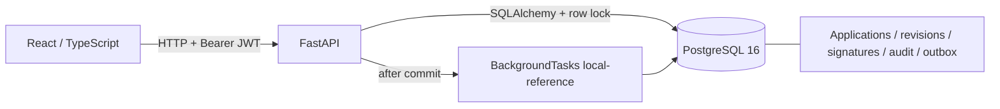

# Архитектура reference baseline

Один процесс приложения и одна БД. PostgreSQL является источником истины; frontend не решает вопросы авторизации. Загрузка байтов файла, SHA-256 и метаданных хранится в БД, без доступа к filesystem paths. Это упрощает атомарность reference; большое файловое хранилище — вне Stage 1.

Изменяющие команды блокируют строку агрегата SELECT FOR UPDATE, сравнивают expected_version и атомарно сохраняют состояние, ревизию/подпись/решение, аудит и outbox. Версия аудита уникальна для заявления, версия outbox — для агрегата. API list ограничивает tenant/owner до пагинации. На конкурентный submit применяется тот же row lock; response snapshot сохраняется вместе с IdempotencyRecord.

HMAC подписывает application UUID, document_version, kind, signer UUID и SHA-256 канонической формы с хешами файлов. Секрет подписи отделён от JWT. Запись подписи не содержит учебного ключа, API не раскрывает proof. При submit и завершении HMAC заявителя проверяется заново.

Local-reference — успешная детерминированная проверка без сети. Два перехода SUBMITTED → VALIDATING → UNDER_REVIEW создают два audit/outbox события в транзакции обработчика. Повторный вызов не меняет актуальное состояние. BackgroundTasks не равен брокеру; outbox пока не доставляется и не имеет consumer/inbox. Недоставленные outbox-записи ожидаемы в этой версии.

Уведомление результата — строка с уникальностью application/kind, delivery_state=LOCAL_INBOX. Отправка email/SMS не реализована. Временное падение сторонней доставки не должно откатывать решение после появления consumer в Stage 2.

Readiness действительно обращается к таблице alembic_version. Время хранится в PostgreSQL как timestamp with time zone; UI отображает локальную дату. Correlation ID проходит в HTTP-ответе, audit и external_checks. В логах нет JWT, пароля или request body.

## Источники

- [FastAPI: JWT и password hashing](https://fastapi.tiangolo.com/tutorial/security/oauth2-jwt/).
- [SQLAlchemy: version counters и ограничения bulk updates](https://docs.sqlalchemy.org/en/20/orm/versioning.html). Здесь выбрана явная проверка версии под row lock.
- [ADR-001: бизнес-решения и последствия](adr/001-core-contract.md).

## Первые будущие WorkLab сценарии (проектирование)

| scenario_id | Цель | Доказательства | Будущая рубрика |
|---|---|---|---|
| govflow-tenant-isolation | Проверить INV-03 | Два пользователя, UUID, HTTP 404, SQL tenant | 40% запросы, 40% isolation asserts, 20% объяснение |
| govflow-submit-idempotency | Проверить INV-02 | Конкурентный submit, SQL COUNT outbox | 40% конкуренция, 40% один эффект, 20% конфликт payload |
| govflow-signature-revision | Проверить INV-07 | Edit/sign/submit, hash до/после | 40% новая ревизия, 40% отказ старой подписи, 20% отчёт |

Это концепты, не опубликованные LMS-задания. Lab API, grader и манифесты должны появиться после Registry/worker; фиктивное оценивание passed=true не добавляется.
