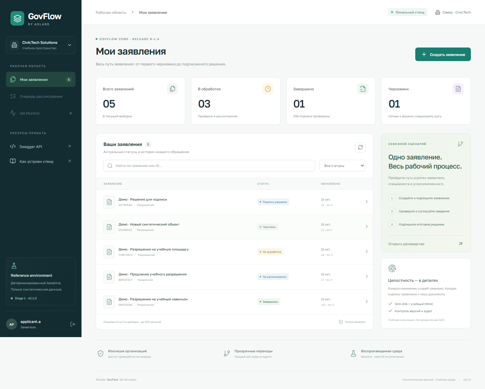

# Запуск и разработка GovFlow

Самостоятельный учебный проект. Реализованы **Stage 0 + Stage 1** из ТЗ: электронное заявление, PostgreSQL, роли и tenant isolation, ревизии, две учебные подписи, локальная проверка, решение и аудит. Интерфейс — React/TypeScript, API — FastAPI.

Это синтетический QA-стенд CivicTech Solutions. Подпись — HMAC-симуляция; не ЭЦП, не NCALayer, не государственный сервис.



## Быстрый запуск

Для запуска нужны Git и Docker с Compose. Docker Desktop должен работать с Linux containers. Конфигурация генерируется временным Python-контейнером; Python и Node.js на хосте нужны только для необязательной локальной разработки.

```powershell
git clone https://github.com/topchik77/adlabs-govflow-qa.git
cd adlabs-govflow-qa
./scripts/start.ps1
```

Для Linux/macOS:

```sh
sh scripts/start.sh
```

- Приложение: <http://127.0.0.1:8014>
- Swagger: <http://127.0.0.1:8014/docs>
- OpenAPI: <http://127.0.0.1:8014/openapi.json>
- PostgreSQL: `127.0.0.1:55434`, отдельный volume `adlabs-govflow_govflow-data`.

Вход: `applicant.a`. Пароль — значение `DEMO_PASSWORD` в созданном локальном `.env`. Пароль и секреты генерируются случайно, не включены в Git и не печатаются в логах. Все учебные пользователи одного стенда используют этот пароль; **не публиковать этот local-only стенд в интернет**.

## Демо за 8–12 минут

1. **Заявитель `applicant.a`:** создать заявление; приложить синтетический PDF/PNG ≤5 MiB; подготовить документ, подписать и отправить.
2. **Специалист `reviewer.a`:** переключиться через профиль слева внизу; в очереди открыть заявление, проверить вкладки «Проверки» и «Аудит», указать основание и одобрить.
3. **Уполномоченный `officer.a`:** открыть решение и подписать. Статус `COMPLETED`; сохранены две разные подписи и уведомление в локальном inbox.
4. **Наблюдатель `qa_observer.a`:** открыть QA Monitor. Значения рассчитаны из БД; детализация документов этой роли запрещена.
5. В Swagger сравнить доступ `applicant.a` и `applicant.b` к одному UUID → 404; повторить submit с одним ключом → тот же ответ, другой payload → 409.
6. Посмотреть [критерии](01-requirements.md), [тестовую стратегию](04-test-strategy.md), [матрицу](tests/traceability.csv) и [релизный отчёт](06-release-report.md).

Для наполнения живыми примерами и сохранения HTTP/DB evidence:

```powershell
docker compose exec -T app python scripts/demo.py
docker compose cp app:/tmp/govflow-demo-evidence.json reports/demo-evidence.json
```

Повторный запуск создаёт только отсутствующие примеры по их названию. Примеры проходят через настоящее API, статусы не рисуются во frontend.

## Проверка

Без установки Python-зависимостей на хост:

```powershell
./scripts/test.ps1
```

Локально с Python 3.12+:

```powershell
python -m venv .venv
./.venv/Scripts/python -m pip install -r services/core-api/requirements.txt
docker compose up db -d --wait
./.venv/Scripts/python -m pytest --tb=short --junitxml=reports/pytest.xml
./.venv/Scripts/ruff check services scripts tests
```

Тесты создают временную PostgreSQL БД `govflow_test_<uuid>`, применяют Alembic, удаляют её после suite. Основная БД и другие проекты не очищаются. Учётная запись тестового PostgreSQL должна иметь CREATEDB. `TEST_DATABASE_URL` позволяет задать отдельный локальный сервер.

Playwright проверяет запущенный стенд. Вариант целиком в Docker:

```sh
docker compose --profile e2e run --build --rm e2e
```

Контейнер E2E использует network namespace приложения: браузер обращается к localhost. Отчёты и screenshots сохраняются в reports на хосте.

Необязательный локальный вариант с Node.js 22.12+ и npm:

```powershell
cd frontend/demo-portal
npm ci
npx playwright install chromium
npm run test:e2e
```

Три браузерных сценария: полный процесс с тремя ролями; мобильный layout/поиск; права QA observer. Они создают синтетические заявления в demo-БД. `reports/pytest.xml` и `reports/playwright.xml` — реальные результаты; скриншоты сохраняются в `reports/`.

## Разработка

Из корня проекта после установки Python-зависимостей:

```powershell
./.venv/Scripts/python -m alembic -c services/core-api/alembic.ini upgrade head
$env:PYTHONPATH = "$PWD/services/core-api"
./.venv/Scripts/python -m govflow.seed
./.venv/Scripts/python -m uvicorn govflow.main:app --host 127.0.0.1 --port 8014
```

Предварительно остановить контейнер app (`docker compose stop app`), чтобы освободить порт. Frontend: `npm run dev` в `frontend/demo-portal`; Vite проксирует API на 8014. Production build раздаётся FastAPI из `frontend/demo-portal/dist`; шрифты включены в сборку, внешняя сеть в UI не требуется.

Экспорт спецификации: `python scripts/export_openapi.py`. Миграции: `alembic -c services/core-api/alembic.ini ...`. Новые зависимости фиксируются в `requirements.txt`, frontend — в `package-lock.json`.

## Seed, reset и остановка

`SEED=42` задаёт стабильные UUID пользователей/организаций. Заявления получают новые UUID; повторяемость сценариев/fault clocks будет добавлена в Stage 2. Идемпотентный seed сохраняет существующие учётные записи и заявления.

Сброс **только выделенной локальной БД `govflow`** (удалит её заявления, подписи и аудит; остановите app перед сбросом при локальной разработке):

```powershell
docker compose exec -T app python scripts/reset.py --confirm-local-reset
```

Пароль берётся из `.env`. Изменение только `DEMO_PASSWORD` без reset не меняет пароль существующих пользователей. Смена JWT_SECRET отзывает ранее выданные токены.

Остановка: `docker compose down`; данные сохраняются в отдельном volume. Никакие команды удаления чужих контейнеров/volume не нужны.

## Структура и границы

`services/core-api/` — доменная модель, API, миграции; `frontend/demo-portal/` — UI и Playwright; `tests/` — PostgreSQL API/SQL/concurrency suite; `docs/` — требования, ADR, тесты и release evidence; `scripts/` — запуск, seed/reset, демо.

**Следующие этапы:** отдельный Registry, RabbitMQ/worker, dispatcher/inbox, controlled retries/DLQ, Fault Engine, mutants, 5 evidence-based bug reports и WorkLab lab API. Они не реализованы и не заявляются как готовые. Stage 1 BackgroundTasks не гарантирует восстановление после падения процесса: запись может остаться SUBMITTED. Полный R-1.4 имеет решение **No-Go** до следующих этапов; локальный baseline оценивается отдельно.

Принятые решения и ссылки на официальные технические источники: [ADR-001](adr/001-core-contract.md), [архитектура](02-architecture.md).
